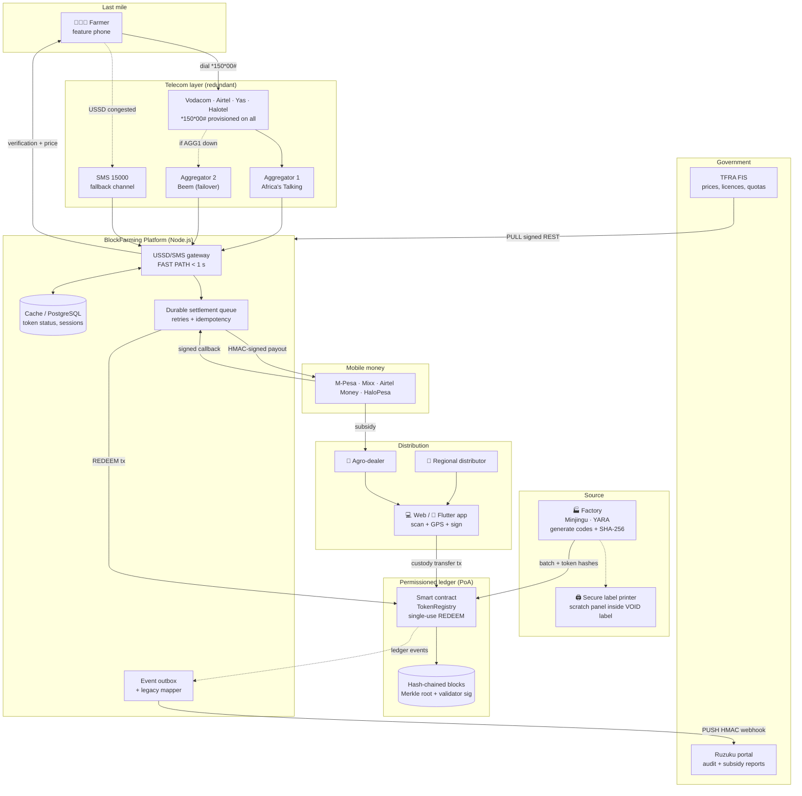
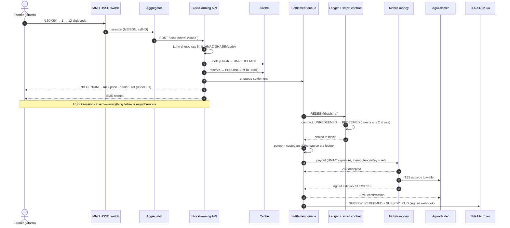
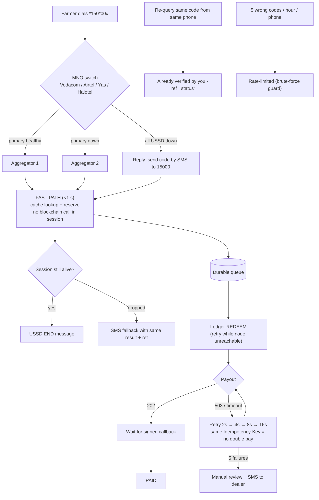
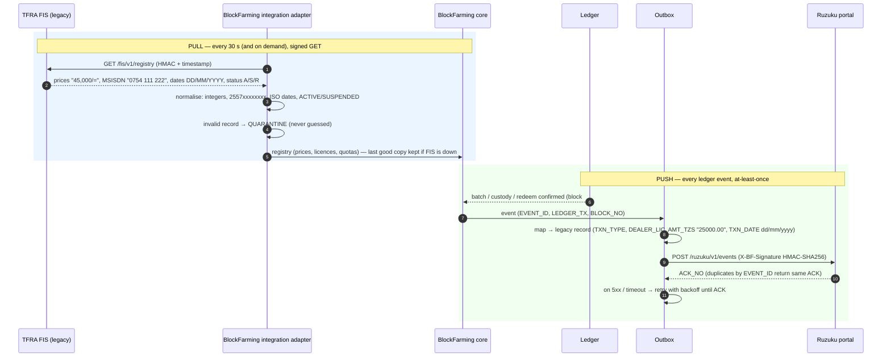
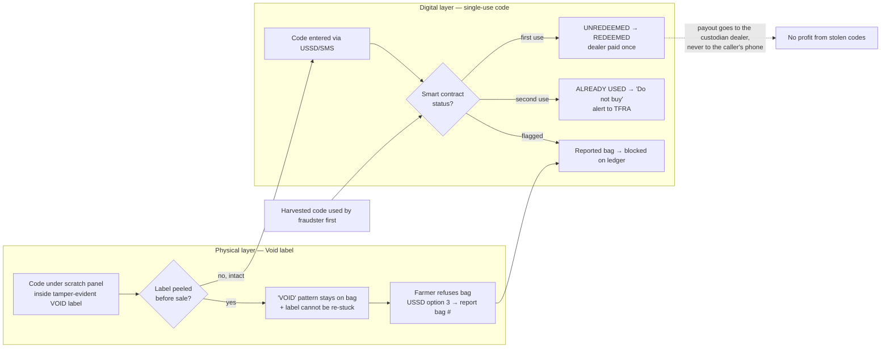
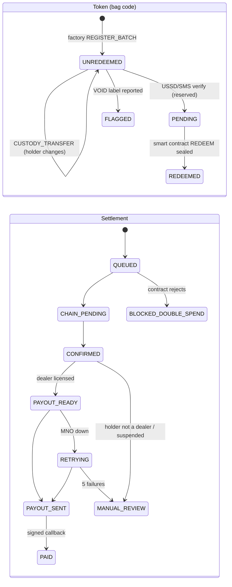

# BlockFarming Architecture

These diagrams render on GitHub, in VS Code (Markdown Preview Mermaid) and in the dashboard Architecture tab.

## 1. System architecture

## 2. USSD verification: fast path + asynchronous settlement

## 3. Telecom and USSD redundancy (judge feedback #2)

## 4. TFRA FIS / Ruzuku integration protocol (judge feedback #3)

## 5. Void label + single-use code (judge feedback #1)

## 6. Token and settlement state machines

